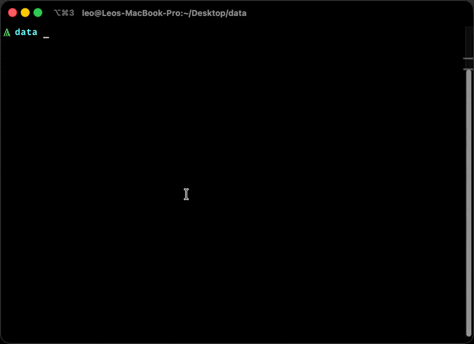

<div>
  <h1 align="center">voir</h1>
  <h4 align="center">
    SQL over tabular files
  </h4>
</div>

[](https://github.com/LeoBorai/voir/actions/workflows/ci.yml)

`voir` runs SQL queries against files, starting with CSV, JSON and JSONC. No schema
declaration, no import step, no server.



## Install

Linux and macOS, one line:

```bash
curl --proto '=https' --tlsv1.2 -sSf https://raw.githubusercontent.com/LeoBorai/voir/main/install.sh | sh
```

The script picks the build for your OS/CPU, verifies its SHA-256 and installs `voir`
to `~/.local/bin`. Options (environment variables):

- `VOIR_VERSION`: release tag to install, e.g. `v0.1.0` (default: latest).
- `VOIR_INSTALL_DIR`: install directory (default: `$HOME/.local/bin`).

Linux builds need glibc (no musl/Alpine). On Windows, download the `.zip` from the
[releases page](https://github.com/LeoBorai/voir/releases). Or build from source:

```bash
cargo install --path crates/voir-cli
```

## Usage

### One-shot queries

```bash
voir "SELECT region, amount FROM 'testdata/sales.csv' WHERE region = 'EU' LIMIT 5"
voir --explain "SELECT * FROM 'testdata/sales.csv'"
voir --format json "SELECT region, SUM(amount) AS total FROM 'testdata/sales.csv' GROUP BY region"
```

Flags: `--explain` (print the logical plan), `--format table|csv|tsv|json|ndjson`
(defaults to `table` on a TTY, `csv` when piped), `--timing` (print execution time).
Exit codes: `0` success, `1` query error.

### REPL

Running `voir` with no query starts an interactive session (history, multiline
input up to a trailing `;`, tab completion for keywords/tables/columns):

```bash
$ voir
voir> SELECT region, COUNT(*) AS n FROM 'testdata/sales.csv'
...>  GROUP BY region ORDER BY n DESC;
```

Meta-commands (psql-style, backslash-prefixed so they never collide with SQL):

| Command                    | Effect                                                   |
| -------------------------- | -------------------------------------------------------- |
| `\open <path> [AS <name>]` | Register a file as a table                               |
| `\dt`                      | List registered tables                                   |
| `\d <table>`               | Describe columns and inferred types                      |
| `\format <fmt>`            | Switch output format                                     |
| `\timing`                  | Toggle execution timing                                  |
| `\explain`                 | Toggle plan printing                                     |
| `\i <file>`                | Execute a `.sql` file                                    |
| `\o <file>`                | Redirect results to a file (`\o` alone resets to stdout) |
| `\?`                       | Help                                                     |
| `\q`                       | Quit                                                     |

### SQL support

`SELECT [DISTINCT] <cols|*> FROM '<file.csv|json|jsonc|bson>' [WHERE <predicate>]
[GROUP BY <exprs>] [HAVING <predicate>] [ORDER BY <exprs> [ASC|DESC]]
[LIMIT n] [OFFSET n]`

- Operators: `AND`/`OR`/`NOT`, comparisons, arithmetic (`+ - * / %`).
- Aggregates: `COUNT(*)`, `COUNT([DISTINCT] x)`, `SUM`, `AVG`, `MIN`, `MAX`.
- `CASE WHEN ... THEN ... [ELSE ...] END` (both simple and searched forms) and
  `CAST(expr AS INT|FLOAT|TEXT|BOOLEAN)`.
- Scalar functions: `UPPER`, `LOWER`, `TRIM`, `LENGTH`, `CONCAT`, `ABS`,
  `ROUND`, `CEIL`, `FLOOR`, `POWER`, `SQRT`, `MOD`, `COALESCE`, `NULLIF`.
- `EXPLAIN <query>` prints the logical plan instead of running it.

See `plan.md` for the full roadmap (joins, subqueries, additional formats).

## Development

```bash
cargo check --workspace
cargo nextest run --workspace
cargo deny check
```

## License

This project is licensed under the MIT license and the Apache License 2.0.
